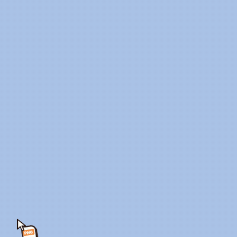

<div align="center">

# Let's Drag!

**Drag any file. Hold Shift. Feed it to the Uncle.**<br>
He chews it up and spits out the format you picked — right next to the original.



$9.50 once, for 2 computers · 100% local: your files are never uploaded

</div>

> **Status: v0.1 private beta.** Builds are produced by CI for macOS (Apple silicon + Intel), Windows and Linux.
> See [the manual test checklist](docs/qa/MANUAL_CHECKLIST.md) and [the project report](docs/REPORT.md).

## How it works

1. Start dragging any file — from Finder, Explorer, your desktop, anywhere.
2. While dragging, hold **Shift** (you can pick Alt/Option, Ctrl or Cmd/Win in Settings).
3. The Uncle pops up at your cursor with his mouth open and the formats he can make around him. His face follows your file.
4. Drop the file on a format. He eats it, chews while the real conversion runs, and tosses out the result — saved **next to the original**, which is never touched or overwritten.

Changed your mind? Hit **Esc** or the little ✕ ("Spit it out") while he chews.
Prefer clicking? Open the **Feed Window** from the tray/menu-bar icon and drop files there.

## What he can eat

| Drop… | He makes… |
|---|---|
| Images (PNG, JPG, WEBP, AVIF, GIF, TIFF, BMP, ICO, HEIC) | PNG · JPG · WEBP · AVIF · PDF · ICO · **Remove background** · Compress |
| Videos (MP4, MOV, MKV, WEBM, AVI) | MP4 · MOV · WEBM · GIF · MP3 · WAV · Compress |
| Audio (MP3, WAV, M4A, AAC, OGG, OPUS, FLAC) | MP3 · WAV · M4A · OGG · FLAC · Compress |
| PDF | PNG pages · JPG pages · Text · Merge PDFs |
| Word (DOCX) | PDF · HTML · Markdown · Text |
| Markdown / Text / HTML | PDF · HTML · DOCX · Text |
| Data (CSV, JSON, YAML, XLSX) | CSV · JSON · YAML · XLSX |
| ZIP | Unzip |
| Anything / folders / mixed | ZIP |

Drop several files at once and he stuffs his cheeks like a hamster. Feed him something huge and he'll sweat a bit.
Feed him an `.exe` and he'll cross his arms. Some things an uncle just won't eat.

*Remove background* uses an AI model that runs on your computer; the first use downloads it once (179 MB).

## Licence ($9.50, one-time)

Downloading is free; converting needs a licence: **$9.50 once, for 2 computers**, all v1.x updates included, 7-day refunds.
Without one the Uncle still pops up, but his bubbles lead to **Unlock for $9.50**: *Buy* opens the checkout (Dodo Payments,
our Merchant of Record) in your browser, *I have a key* opens **Settings → Activate**. Paste the key from the email and press
Activate. To move the licence, use **Settings → Deactivate this computer** on the old one.

Activating needs the internet once. After that the app re-checks the licence now and then in the background (silently, at
most once a day) and never locks just because you're offline. It locks only if the key was refunded or disabled.

## Install (beta)

Download the installer for your system from the latest [release](https://github.com/dev-wm-monsters/let-us-drag/releases) / CI build.

- **macOS** — open the `.dmg` and drag *Let's Drag!* to Applications. The beta is not notarized yet, so the first time:
  right-click the app → **Open** (on macOS 15: try to open it once, then *System Settings → Privacy & Security → Open Anyway*).
  Then allow **Accessibility** when asked — that is how the app notices "dragging + Shift". It sees only that; it records and sends nothing.
- **Windows** — run the `setup.exe` (or the portable `.exe`). SmartScreen may warn about an unknown publisher: **More info → Run anyway**.
- **Linux** — AppImage or `.deb`. The global gesture needs an X11 session; on Wayland use the Feed Window.

## Privacy

Everything happens on your machine. No accounts, no telemetry, and your files are never uploaded. The only network access is:

- the licence calls to Dodo Payments (activate, the occasional background re-check, deactivate). They send only the licence key,
  an anonymous device ID (a random number made on this computer) and a device label such as `macOS · Apple silicon · 3f9a2c`;
  never your computer name, user name or anything about your files;
- the optional one-time download of the background-removal model, from its upstream source, verified by SHA-256.

## Build from source

```bash
npm ci
npm run dev          # run the app in development
npm test             # unit + engine tests
npm run build && xvfb-run -a npm run test:e2e   # end-to-end tests (Linux; a mock Dodo server, no network)
node scripts/fetch-ffmpeg.mjs && npm run dist:mac   # or dist:win / dist:linux
```

Licensing is configured at build time (no secrets, the app holds no Dodo API key): `DODO_ENV=test|live` and
`DODO_PRODUCT_ID=pdt_…` (default: test mode with the test product; CI reads the repository variables `DODO_ENV` /
`DODO_PRODUCT_ID`). `node scripts/dodo-smoke.mjs <test licence key>` checks activate → validate → deactivate against Dodo's test
host. Details: [docs/TPM_DECISIONS.md](docs/TPM_DECISIONS.md) D26.

Tech: Electron · TypeScript · React · sharp/libvips · FFmpeg · pdf.js · ONNX Runtime. Architecture and decisions:
[docs/PLAN.md](docs/PLAN.md), [docs/TPM_DECISIONS.md](docs/TPM_DECISIONS.md), security model: [docs/security](docs/security).

## Contributing

Bug reports and ideas are welcome — please open an issue with your OS, the file type and what the Uncle did.
Want to give the Uncle a friend? Characters are layered SVG + a state machine (`src/renderer`); custom skins are on the roadmap.

## License

MIT for the app. Bundled third-party software keeps its own licence (FFmpeg is GPL and ships as a separate program) — see
[THIRD_PARTY_NOTICES.md](THIRD_PARTY_NOTICES.md).
