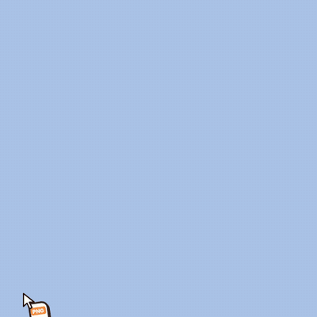

# The Uncle — art & visual QA

`hero.gif` is the README hero (drag → appear → head follows the file → eat → chew → spit, ~6 s,
400 px, flat background). `uncle-eat-chew-spit.gif` is the shorter state loop on the fake desktop.

The Uncle is code, not image files: a layered inline SVG (`src/renderer/common/uncle/UncleSvg.tsx`)
animated every frame by a small pure "brain" (`pose.ts` → `attrs.ts`). Screenshots of every state
live in [`screens/`](screens/).

## Regenerating art

| What | Command | Output |
|---|---|---|
| App icon + tray icons | `node src/renderer/dev/render-art.mjs icons` | `resources/icon.png` (1024²), `resources/tray/trayTemplate.png` (16², black+alpha), `trayTemplate@2x.png` (32²), `tray.png` (32², colour) |
| Static poses (art review) | `node src/renderer/dev/render-art.mjs poses <dir>` | `<dir>/pose-<mood>.png/.svg` + `sheet.png` |
| Screenshots of every state + GIFs | `node src/renderer/dev/capture.mjs [filter…]` | `docs/art/screens/*.png`, `docs/art/hero.gif` (scenario `hero`), `docs/art/uncle-eat-chew-spit.gif` (scenario `gif`); with `LUD_SCREENS_DIR` set, the PNGs **and** GIFs go there and docs/art is not touched |
| Smoke check of the renderer side of the E2E hooks | `node src/renderer/dev/verify-hooks.mjs` | console (exit 1 on failure): feed drops, cancelActive, "Spit it out", Esc, `data-uncle-mood`; at 560x560: D20 click-through toggling, D21 arm over a card, chew stage text, every option hint inside the window and off the other bubbles, 140/200-char error cards inside the window; feedMe with held files (B-064): every bubble reachable at its centre (`elementFromPoint`), off the held-files chip and inside the window / drop zone for 1–8 options, in the overlay and the Feed Window at 380x460, 364x421 and its 300x340 minimum, plus drag and click hit-testing in the scaled-down minimum Feed Window |
| Poke the UI by hand | `node src/renderer/dev/serve.mjs` | prints harness URLs |

All of these use only installed packages (vite, @vitejs/plugin-react, react-dom/server, sharp,
playwright) plus `ffmpeg` for the GIF (`LUD_FFMPEG_PATH` or PATH).

## How the visual harness works

1. `src/renderer/dev/vite-dev.mjs` starts a programmatic Vite dev server rooted at `src/renderer`.
2. `dev/harness.html?view=overlay|feed|settings` loads `dev/harness.tsx`, which installs an in-memory
   `window.lud` (`dev/mock-lud.ts`, implements the full `LudApi`) and then imports the **real**
   window entry (`overlay/main.tsx`, `feed/main.tsx` or `settings/main.tsx`).
3. Query parameters: `plain=1`, `hungry=1`, `sounds=1`, `firstRun=1`, `jobs=auto|manual`,
   `platform=darwin|win32|linux`, `reason=wayland|mac-permission|hook-failed`, `bg=flat` (overlay on one
   flat colour instead of the fake desktop gradient; used for the hero GIF).
4. `window.__harness` drives it (from Playwright `page.evaluate` or DevTools):
   - `drag('dragenter'|'dragover'|'drop'|'dragleave', x, y, [{ name, type }])` dispatches a real
     `DragEvent` with a `DataTransfer` holding `File`s → exercises the same code path as an OS drag;
   - `optionPoint(optionId)`, `center()`, `state()` (= `data-uncle-state`), `key('Escape')`;
   - mock channels: `emitJobEvent(ev)`, `lastJobId()`, `arm()`, `disarm()`, `cursor({x,y})`,
     `testDrop({ paths, optionId })`, `testFeedDrop({ paths, optionId })`, `testCancel()`,
     `changeSettings(patch)`; logs in `calls` / `jobs`. The mock `cancelJob` answers with a `CANCELLED` error
     like the engine does.
   - mock paths: `pathsForFiles` → `/Users/demo/Desktop/<name>`; names containing `huge`/`big` are
     350 MB (struggle), names containing `broken` fail in `jobs=auto` mode.
5. `capture.mjs` launches Chromium (`LUD_CHROMIUM_PATH`, else the newest
   `$PLAYWRIGHT_BROWSERS_PATH/chromium-*/chrome-linux/chrome`; Playwright 1.64 expects a newer build
   than the preinstalled one, so the explicit path is required here), runs each scenario, asserts
   `data-uncle-state`, and saves palette PNGs. The GIF is recorded with the CDP screencast (real-time
   frames, re-timed to a constant fps by timestamp) and encoded with ffmpeg (Playwright's own video
   recorder needs an ffmpeg build that is not installed here). The hero GIF adds a fake drag image
   (arrow + file card, `pointer-events: none`) because a synthetic drag has no visible cursor.
   Env: `LUD_SCREENS_DIR`, `LUD_GIF_PATH`, `LUD_HERO_PATH`, `LUD_FFMPEG_PATH`, `LUD_CHROMIUM_PATH`.
6. The mock also records `setOverlayClickThrough` (`__harness.clickThrough()` = last value; `arm()`
   resets it to false like main does).

## Rig notes (phase 2)

- **Head turn** (`pose.ts`): the head rolls up to ±11° toward the look target around the neck, the
  face layers shift with strong parallax (nose 38, moustache 33, eyes/brows 25, skull 11, ears/hair
  the other way), and `turnRig()` foreshortens the far side: the far eye narrows (to ~0.64 at a full
  turn), the far temple of the glasses shortens, the far ear slides in and squashes, the face group
  compresses slightly. All of it is spring-smoothed (critically damped, no overshoot/jitter). The
  pupils are solved through the whole rig (`headInverse` → face/eye inverse) so they stay locked on the
  file however far he turns (unit test: < 4° error). Reduced motion keeps 30 % of the turn.
- **Mole** (`attrs.ts` `MOLE`, `UncleSvg.tsx`): a 10-unit cheek mole beside the nose with a soft
  highlight and one curly 3.4-unit hair that sways a little; visible at the 220–260 px overlay size.
- **Cancel** (TPM D3): state `cancel` — "ptoo!" (cheeks puff, mouth pops, the file card flies back
  out towards where it came from), then a "fine, whatever" shrug with the bubble "Fine, keep it.", then
  leave. The "Spit it out" button (`data-testid="cancel-job"`) sits on the progress ring at the
  top-right only while chewing; the hamster "nom ×N" badge moved to the top-left to make room.
  Screens: `overlay-18-cancel-button`, `overlay-19-cancel-spit-back`, `overlay-20-cancel-fine-keep-it`.

## Phase 4 notes (stabilisation)

- **Click-through (TPM D20)**: after the drop (eat, chew, spit, choke, cancel, leave) the overlay asks
  main for `setOverlayClickThrough(true)`; it turns it off while the pointer is over the "Spit it
  out" button or a result card (`pointerenter`/`pointerleave`, i.e. mouse moves forwarded on
  macOS/Windows, and a hit test on main's cursor polling, which also covers Linux where moves are
  not forwarded). Focus (`setOverlayInteractive(true)`) is only requested in feedMe; result cards
  work by click without focus. A new arm drops any card at once (D21).
- **Hints** are placed by `placeHint()` (`geometry.ts`): below, above, towards the Uncle or outwards,
  whichever stays inside the window and covers no other bubble; long hints wrap (max 230 px).
  Screen: `overlay-03-hover-remove-bg`.
- **Stage text** under the progress ring while chewing (D15): the engine's stage, with the download
  percentage during the one-time Remove BG model download. Screens: `overlay-12-struggle`,
  `overlay-21-download`.
- **Cards** wrap up to 6 lines of 13 px text (engine messages are capped at 200 characters) and move
  up when they would leave the window. Screen: `overlay-22-choke-long` (560x560, 200 chars).
