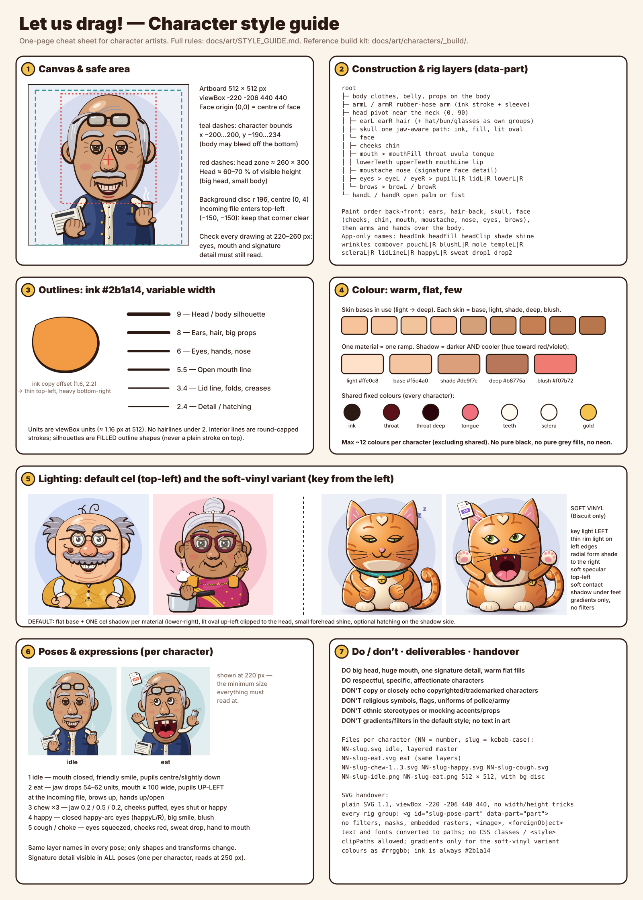

# Let us drag! character style guide



This guide is for anyone drawing a character for Let us drag!. A character's job is to eat the files
people drag in, chew while the file converts, and spit out the result. Every character has to slot into
the in-app rig (`src/renderer/common/uncle/`) and look like part of the existing family in
[`characters/`](characters/README.md). The reference implementation is the build kit in
`characters/_build/` (`lib.mjs` holds the shared shapes, `chars/*.mjs` one file per character).
The visual sheet above is regenerated with `node docs/art/characters/_build/style-guide.mjs`.

## 1. Canvas and safe area

- **Artboard:** 512 × 512 px, `viewBox="-220 -206 440 440"`. The origin `(0, 0)` is the centre of the
  face, the same as the in-app Uncle (so `HEAD_CENTER` and the options ring line up). y grows downwards.
- **Character bounds:** x −200…200, y −190…234. The body may run off the bottom edge, but the head,
  ears, hats and raised hands must stay inside.
- **Head zone:** about 260 wide × 300 tall, centred slightly above the origin. The head (with hair or
  hat) is about 60–70 % of the visible figure height. Big head, small body.
- **Background (PNG renders only):** a flat square plus a disc of r 196 at `(0, 4)`, in two tints
  of the character's colour. SVG masters have no background.
- **Keep the top-left corner clear** (around `(−150, −150)`). That is where the incoming file flies in
  during the eat pose.
- **Readability test:** view every pose at 220–260 px. The eyes, the mouth shape and the signature
  detail must read at that size. If a detail needs zooming in to understand, make it bigger or drop it.

## 2. Construction and layer names

Every animatable piece is its own `<g>` with `data-part="<name>"` and a document-unique
`id="<slug>-<pose>-<name>"`. Use these names exactly; the rig looks them up by name.

```
root
├─ body                       clothing, belly, anything attached to the torso
├─ armL / armR                rubber-hose arm: fat ink stroke under a sleeve-colour stroke
├─ head                       rotates and squashes around the neck (≈ 0, 90)
│  ├─ earL / earR
│  ├─ hair                    (+ hats, buns, glasses, toupee as their OWN groups, e.g. glasses, cap)
│  ├─ skull                   one jaw-aware head path: ink copy, shade fill, lit oval, shine
│  └─ face
│     ├─ cheeks   chin
│     ├─ mouth > mouthFill, throat, uvula, tongue, lowerTeeth, upperTeeth, mouthLine, lip
│     ├─ moustache / beard, nose, signature face detail
│     ├─ eyes > eyeL / eyeR > pupilL|pupilR, lidL|lidR, lowerL|lowerR (smile lids)
│     └─ brows > browL / browR
└─ handL / handR              open palm or fist
```

The in-app Uncle also uses `headInk`, `headFill`, `headClip`, `shade`, `shine`, `wrinkles`,
`combover`, `pouchL/R` (chew puffs), `blushL/R`, `mole`, `moleHair`, `templeL/R`, `scleraL/R`,
`lidLineL/R`, `happyL/R` (closed happy eyes), `sweat`, `drop1`, `drop2` (see `PART_KEYS` in
`attrs.ts`). Add them if your character needs that behaviour. Props get descriptive names of their own
(`cooker`, `meter`, `tumbler`, `bell`, `tail`, `contactShadow`).

Construction rules:

- **Head:** one closed path. The jaw is part of the head silhouette, so the chin moves down when the
  mouth opens (54–62 units at a full open, compared with 30 for the Uncle). Don't draw a separate jaw
  piece.
- **Eyes:** the sclera is an ink-rimmed oval. The pupil (plus iris) sits in a group **clipped to the
  sclera**, so the rig can slide it around. The upper lid is a skin-coloured shape that comes down from
  the top, with a 3.4 ink line on its edge. The lower lid works the same way from below, for smiles.
- **Mouth:** `mouthFill` is the open shape. Throat, uvula, tongue and teeth sit inside a clip of that
  shape, and `mouthLine` is the ink edge drawn on top.
- **Brows:** separate filled shapes, so they can move up and down and tilt.
- **Hands:** chunky cartoon hands (four fingers are fine) with a cuff, or a fist for holding a prop.
  Arms are simple curved hoses with no elbows.
- **Paint order, back to front:** body, ears, back hair, skull, face (cheeks, chin, mouth, moustache,
  nose, eyes, brows), front hair or hat, then arms and hands.

## 3. Outlines

- **Ink is always `#2b1a14`** (a warm near-black). Never use pure black.
- **Silhouettes are filled outline shapes, not strokes.** Each form is drawn twice: an ink copy (fill
  plus a thick ink stroke) shifted by `translate(1.6 2.2)`, with the colour copy on top. That gives a
  line that is thin top-left and heavy bottom-right, like a brush.
- **Stroke weights** (viewBox units, about 1.16 px each at 512):

| Element | Weight |
|---|---|
| Head and body silhouette | 9 |
| Ears, hair masses, large props | 8 |
| Eyes, nose, hands, small props | 6 |
| Open mouth edge (`mouthLine`) | 5.5 |
| Lid lines, folds, creases, smile lines | 3–3.4 |
| Detail, hatching, fingers | 2.4 (minimum 1.8) |

- Interior lines are round-capped, round-joined strokes in ink, or in the material's `deep` tone for
  softer creases.

## 4. Colour

- **Warm and flat.** Each material (skin, hair, each garment) gets a ramp of `light`, `base`, `shade`
  and `deep`, plus `blush` for skin. Fill with flat colour; gradients belong only to the soft-vinyl
  variant.
- **Skin tones** in use run from `#f6c39b` (Uncle) to `#b8764c`. Pick from that range or nearby, and
  vary it across the cast.
- **Shadow = darker and cooler.** Shift the hue slightly toward red or violet and lower the lightness
  (for example base `#f5c4a0` → shade `#dc9f7c`). Never just add grey or black.
- **At most about 12 colours per character**, not counting the shared ones: ink `#2b1a14`, throat
  `#5a1119`/`#2a050b`, tongue `#f0707e`, teeth `#fffaf0`, sclera `#fffdf6`, gold `#f4c34d`.
- Give each character a two-tone background tint that differs from its neighbours in the cast, and
  make the signature detail the most saturated thing on the figure.

## 5. Lighting

**Default (every character): flat cel shading, light from the top left.** Use one shadow tone per
material, on the lower right of each form. Add a lit oval (the base colour) up-left inside the head
clip, a small forehead shine, and optional editorial hatching (2.4, `deep` tone) on the shadow side.
Don't use gradients, glows or drop shadows.

**Soft-vinyl variant (Biscuit the cat only, or when a brief asks for it).** The key light comes from
the **left**:

- Give each main form a radial gradient (`light` → `base` → `shade`) centred at about 30 % / 30 %, so
  the form shadow falls smoothly to the right.
- Add a rim light on the left edge. Clip to the form, fill it with a pale rim colour, then lay the
  gradient-filled copy over it shifted 4–6 units right, so only a thin sliver on the left stays bright.
- Add a soft white specular top-left (a radial gradient that fades to transparent).
- Add a soft contact shadow under the feet: an ellipse with a radial gradient in a cool violet
  (`#3a2f5a`, 0.5 → 0 opacity), plus a slightly darker small ellipse under each foot.
- Keep the same ink outlines. Use gradients only, never SVG filters (blur and the like).

## 6. Required poses and expressions

Deliver every pose with the same layer structure. Only shapes and transforms change between poses.

1. **Idle:** mouth closed with a friendly smile, pupils centred or slightly down, lids relaxed.
2. **Eat:** jaw fully dropped, mouth at least 100 units wide with teeth, tongue and throat showing.
   Pupils look **up-left** at the incoming file, brows go up, hands go up and open.
3. **Chew** (three frames): jaw at about 0.2 / 0.5 / 0.2, cheeks puffed, eyes shut or happy.
4. **Happy:** closed happy-arc eyes (`happyL/R`), a big smile and blush.
5. **Cough / choke:** for a failed conversion. Eyes squeezed shut, cheeks red, a sweat drop, a hand to
   the mouth.

## 7. The signature-detail rule

Every character gets **exactly one** signature detail that tells you who they are at 250 px: Dadi's
pressure cooker, the auto-wala's fare meter, Chacha's glasses pushed up on his head, Biscuit's forehead
heart. It shows in every pose, sits in its own group, and ideally has a state the app can drive
(progress, a beat while chewing, the result). Supporting props are fine, but they must not compete
with it.

## 8. Do and don't

- **Do:** a big head, a huge mouth, warm flat fills, a clear silhouette that differs from the rest of
  the cast (check it as a black fill), affectionate and specific people.
- **Don't copy copyrighted or trademarked characters,** or echo them closely. A reference can inspire
  a genre, a mood or a lighting setup, but never eye shape, markings, proportions or costume. (Biscuit
  is an orange tabby with almond eyes, a heart patch and a bell collar, deliberately unlike any famous
  comic cat.)
- **Don't use religious symbols,** sacred marks or ritual objects, flags, or police and army uniforms
  or badges.
- **Don't use stereotypes:** no caricatured features, mocking accents or "costume" versions of a
  culture. Draw an individual with a job, a habit and a prop.
- **Don't put text in the art** (except a prop's tiny label, if it's needed and converted to paths),
  and don't use logos or real brands.

## 9. Deliverables and naming

For each character, `NN` is the two-digit number and `slug` is kebab-case (for example
`11-biscuit-cat`):

| File | Content |
|---|---|
| `NN-slug.svg` | Idle, the layered master |
| `NN-slug-eat.svg` | Eat pose, same layers |
| `NN-slug-chew-1.svg` … `-chew-3.svg` | Chew frames |
| `NN-slug-happy.svg`, `NN-slug-cough.svg` | Expressions |
| `NN-slug-idle.png`, `NN-slug-eat.png` | 512 × 512 renders with the background disc |

Also send a short note with the name, origin, signature detail, catchphrase, and how the character
eats, chews and spits (the same fields as `meta` in `_build/chars/*.mjs`).

## 10. How to hand over SVGs

- Plain SVG 1.1 with `viewBox="-220 -206 440 440"`, `width="512" height="512"`, and a `<title>`.
- Every rig group gets `<g id="slug-pose-part" data-part="part">`, using the names in section 2.
  Illustrator and Figma layer names usually export as `id`, so name the layers that way and add
  `data-part` (or ask us to script it).
- **No** filters, masks, blend modes, embedded rasters, `<image>`, `<foreignObject>`, `<style>` or CSS
  classes, and no symbols or `<use>`.
- **Fonts converted to paths.** Colours as `#rrggbb` fills on the elements themselves.
- `clipPath` is allowed (eyes, mouth, head shading). Gradients are allowed only for the soft-vinyl
  variant.
- Keep paths editable: no expanded strokes on interior lines, and keep the ink-copy-under-colour
  construction, not a merged outline.
- Before sending, render it at 240 px and look at it next to `characters/storyboard.png`.
