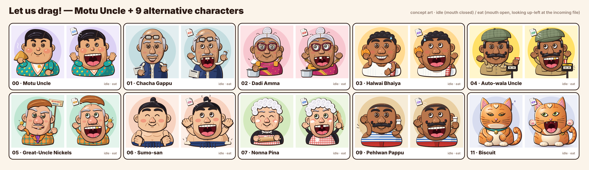

# Alternative character concepts



Motu Uncle (a chubby foodie uncle, redesigned to stand apart from the in-app Uncle) and nine alternative characters to choose from (round 3: Chacha Gappu restyled, Captain Chomp and Abuela Rosa dropped, Biscuit the cat added). The rules for new art are in [`../STYLE_GUIDE.md`](../STYLE_GUIDE.md). **Concept art only:** nothing here is
wired into the app. Open [`storyboard.html`](storyboard.html) for the full sheet (it is self-contained,
with inline SVG and no external resources): name, origin, signature detail, how each one eats, chews
and spits a file, and both poses side by side.

| File | What |
|---|---|
| `NN-slug.svg` | Idle pose, layered SVG (the master drawing) |
| `NN-slug-eat.svg` | Eat pose: the same layers with the jaw/mouth, eyes, brows and arms changed |
| `NN-slug-idle.png`, `NN-slug-eat.png` | 512×512 renders (sharp) |
| `storyboard.png`, `storyboard.html` | Overview sheet |
| `_build/` | Generator: `node docs/art/characters/_build/render.mjs [slug…]` rewrites every file above |

They are built the same way as the Uncle (`src/renderer/common/uncle/UncleSvg.tsx`). Ink lines are
filled outline shapes: an ink copy of each form, offset down-right, sits under the colour copy, so the
line is thin top-left and heavy bottom-right. Colours are flat and warm, with one cel-shadow tone per
material, a lit ellipse clipped to the head, and editorial hatching on some shadow sides. Every
character has a huge mouth (the jaw drops 54–62 units, against the Uncle's 30) and one signature detail
that still reads at about 250 px.

## The characters

**00 · Motu Uncle** (India; redesigned so he no longer reads as "the Uncle, but fatter"). The
neighbourhood's happiest foodie: a big round moon face with puffed rosy cheeks and a soft double chin,
small squinty smiling eyes, short thick arched black brows, a little button nose and no moustache at
all. His black hair is oiled flat with a side parting and a swept front, with short sideburns. He
wears a bright turquoise half-sleeve bush shirt with a yellow-and-orange mango print, stretched over a
huge round belly, and has short chubby arms with sausage fingers. Signature: the white napkin tucked
into his collar (orange border, one permanent haldi stain), which flaps when he chews; in idle he
holds up a steaming samosa. None of the Uncle's parts are reused (no glasses, mole, grey tufts,
comb-over, bushy moustache, gold tooth, argyle vest or bow tie), and the palette (turquoise, mango
yellow, black hair on a lavender background) sits apart from Chacha's cream-and-navy and Halwai's
white-and-red.

**01 · Chacha Gappu** (India; restyled in round 3 so he no longer reads like Halwai Bhaiya). The
retired colony chacha: older and lanky, with a tall egg-shaped head, a shiny bald dome, grey side hair
with a side parting (and three brave strands across the top), bushy grey brows, heavy-lidded eyes with
crow's feet, a long narrow nose and a neat grey moustache. Thick black reading glasses sit pushed up on
his forehead (in the eat pose they have slid halfway down). He wears a cream kurta under an open navy
waistcoat, has the morning paper under one arm and a steel tumbler of cutting chai in his hand.
Signature: the glasses on the forehead plus the paan-red grin. The palette is cool (navy, steel, cream
on a pale teal background) where Halwai is warm white and red, and the silhouette is tall and narrow
where Halwai is round. He sips chai between bites, and the glasses slide down at every chew.

**02 · Dadi Amma** (India). A silver bun with a jasmine gajra, big maroon cat-eye glasses on a beaded
gold chain, a magenta saree with a gold-bordered pallu, gold bangles and stud earrings. Her smile is
soft, and when the mouth opens it is wide and gap-toothed. Signature: the steel pressure cooker. It
whistles once per 25 % while she chews, and its final "phweeet!" means the conversion is done. In idle
she holds the cooker handle and cups her cheek with the other hand.

**03 · Halwai Bhaiya** (India). A chubby sweet-shop owner in a white ribbed baniyan with bare
shoulders. He has a red-checked towel on his shoulder, tight curls, stubble, a double chin and a sweat
drop from the kadhai. Signature: a giant, glistening jalebi held up like a trophy. The progress ring
could be drawn as a jalebi coiling itself.

**04 · Auto-wala Uncle** (Mumbai). A khaki uniform shirt with flap pockets and a pen, a tweed flat cap
worn at an angle, sideburns, a gold tooth, and a magnificent curled handlebar moustache. Signature: the
black-and-yellow mechanical fare meter. In idle the flag is up and the meter reads 00.00. In eat the
flag is down and the fare ticks (18.50), so the meter is the progress bar. Note: a first pass with a
peaked uniform cap and a brass badge read as a police officer, so both were removed.

**05 · Great-Uncle Nickels** (the "Grunkle-style" con man). Inspired by the *genre* of the lovable
scheming great-uncle, and deliberately original: no fez, no eyepatch, no glasses, no black suit, no
stubble. He wears a loud orange-and-teal plaid jacket, a purple polka-dot tie and a carnation, and has
a long face with a big cleft chin, a pencil moustache, one eyebrow shot up, a lopsided smirk and a gold
tooth that glints. Signatures: the coin (one per file; he bites it to check it is real) and the
hand-painted MYSTERY DEALS sign. Running gag: his crooked toupee lifts clean off his head when he
gulps.

**06 · Sumo-san** (Japan). A gentle, polite giant, drawn respectfully: an oiled black topknot,
closed-eye contented smile, rosy cheeks, a broad bare chest and a navy mawashi with hanging cords. The
design uses no ring rituals or religious elements. Signature: the shiko stomp. While he chews he
stomps left and right, the topknot boings and dust puffs fly (both are shown in the eat pose). Lines:
"Itadakimasu!" before he eats, "Gochisōsama deshita" when he hands the result over.

**07 · Nonna Pina** (Italy). A cloud of tight white curls, happy squinting eyes with crow's feet,
pearls and a lace collar, a black dress and a red gingham apron with a floury handprint. Signature: the
rolling pin, and flour dusted on her rosy cheeks. She rolls the file flat like pasta dough and slurps
it like tagliatelle. The progress ring could fill like rising dough.

**09 · Pehlwan Pappu** (India). A village akhada wrestler-uncle with a buzz cut, a curled moustache
and a big round belly in a blue-striped vest over red langot-style shorts. Akhada mitti (dust) sits on
his shoulders and arm. Signature: a tall glass of milk with a foamy top. In idle he flexes one arm and
raises the glass with the other. While he chews he grunts every 10 %, and dust puffs off his shoulders.

**11 · Biscuit** (the sofa). An original chubby, lazy orange tabby. Separate almond eyes with heavy
sleepy lids and green irises (slit pupils in idle, round and wide when he eats), a small pink nose, a
little "w" mouth with a smug smile, cream chin, throat, belly and feet, darker-orange tabby bars on the
cheeks, brow, flanks and the curled tail, and chunky paws with pink beans. Signature: a cream heart on
his forehead, plus a teal collar with a gold bell that rings once per file. He is deliberately not a
famous comic cat: no big conjoined round eyes, no muzzle blob, no black head stripes. **Lighting
variant:** Biscuit is lit like a soft vinyl toy, with the key light from the left (a rim light on the
left edges and a soft specular top-left), smooth radial form shadows falling to the right, and a soft
contact shadow under his feet. All of it is done with gradients, not filters (see `vinyl()` in
`_build/chars/11-biscuit-cat.mjs`). He also uses rig groups that the people don't have: `tail`,
`footL`/`footR`, `collar`, `bell`, `heart`, `whiskers` and `contactShadow`.

## Mapping onto the existing animation rig

Every SVG uses the Uncle's layer vocabulary. Each group has `data-part="<rig name>"` and a document-unique
`id="<slug>-<pose>-<rig name>"`:

```
root
├─ body                         (bodyY bob; clothing, belly, props attached to the body)
├─ arm L/R  → arm L/R ink+sleeve paths (armPath: shoulder → wrist, rubber hose)
├─ head                         (headX/headY/headRot/squash, pivot near the neck)
│  ├─ earL/earR, hair / bun / topknot / toupee / cap / glasses   (parallax "behind" layers)
│  ├─ skull                     (headInk/headFill/headClip: one jaw-aware path per character)
│  └─ face                      (turnRig foreshortening)
│     ├─ cheeks (blush, smile creases)   ├─ chin
│     ├─ mouth > mouthFill, throat, uvula, tongue, lowerTeeth, upperTeeth, mouthLine, lip
│     ├─ moustache / beard / nose / signature face detail (paan stain, flour, heart patch …)
│     ├─ eyes > eyeL/eyeR > pupilL/pupilR, lidL/lidR (+ lowerL/lowerR smile lids)
│     └─ brows > browL/browR
└─ handL/handR                  (open palm or fist; same HAND/THUMB shapes as the Uncle)
```

What porting one would take:

- **Jaw.** Each skull comes from `headD({... jaw})` in `_build/lib.mjs`, which generalises
  `paths.ts → headPath` (chin drop = `jaw × drop`, jowl easing). The eat mouth (`mouthOpen`) is
  `mouthPath` with a wider `w` and a deeper `bottom`. A port turns both into procedural functions of
  `pose.jaw` and `pose.smile`, then tweens between the two poses drawn here (idle `mouthClosed`, eat
  `mouthOpen`). Halwai's stubble is already parameterised by the jaw.
- **Eyes.** These are the same parts the Uncle uses: clipped pupils, which `pupilOffset` can drive
  directly, and an upper lid (`lidPath`). The new lower "smile" lid (`lowerL/lowerR`) maps to
  `pose.happy`. In idle, Sumo-san and Nonna draw closed happy arcs, which is the Uncle's `happyL/happyR` state.
- **Head turn / parallax.** `DEPTH` applies as-is to `ears`, `hair`, `brows`, `eyes`, `nose`,
  `moustache` and `mouth`. Hats, buns, topknots and the toupee are separate groups, so they can take
  the hair depth plus their own spring (secondary motion, like the Uncle's comb-over).
- **Signature props are separate groups with obvious state hooks:** `cooker` (whistle and steam per
  25 %), `meter` (flag rotation + digits = progress), `sign`/`coin`, `rollingPin`, `jalebi`, `stompDust`/`topknot` (chew beat), `toupee`
  (lifts at `jaw > 0.8`), `milk`, `tumbler`/`newspaper`/`glasses` (Chacha), `bell`/`tail` (Biscuit), `napkin`/`samosa` (Motu Uncle: the napkin flaps on the chew beat).
- **Canvas.** The viewBox is `-220 -206 440 440`, with the face origin at (0, 0) as in the Uncle, so
  `HEAD_CENTER` and the options ring carry over.
